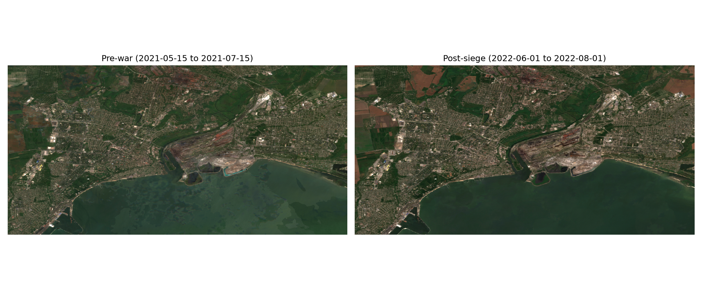

# Detecting Cumulative Urban Conflict Damage in Mariupol from Sentinel-2 Change Indices

Can 10 m Sentinel-2 change indices (ΔNDBI and ΔNDVI) detect and quantify cumulative war damage in Mariupol, Ukraine, above seasonal and atmospheric noise? This project tests that question with an open, reproducible workflow and a spatially validated evaluation.

> **Status: work in progress.** Started November 2026. Data ingestion and cloud masking are done; index computation and validation are next.



*Median Sentinel-2 composites of the study area: summer 2021 (pre-war) and summer 2022 (post-siege).*

---

## Research question

Do changes in vegetation (NDVI) and built-up (NDBI) indices between a pre-war and a post-siege period reliably separate damaged urban areas from unchanged areas, once seasonal and atmospheric variation is accounted for?

## Study area and data

| | |
| --- | --- |
| **Area** | Mariupol, Ukraine. Bounding box (WGS84): W 37.48, S 47.05, E 37.68, N 47.15 |
| **Satellite data** | Sentinel-2 Level-2A surface reflectance (`COPERNICUS/S2_SR_HARMONIZED`) via Google Earth Engine |
| **Bands** | B2, B3, B4 (visible), B8 (NIR), B11, B12 (SWIR) |
| **Pre-war window** | 15 May to 15 July 2021 |
| **Post-siege window** | 1 June to 1 August 2022 |
| **Resolution / CRS** | 10 m, EPSG:32637 (UTM zone 37N) |

Both windows fall in early to mid summer so that vegetation seasonality is as similar as possible between the two periods.

## Method

1. **Ingest** Sentinel-2 scenes for the study area and both time windows.
2. **Cloud mask** each scene using the Scene Classification Layer (SCL), removing no-data, saturated, cloud shadow, medium and high cloud probability, thin cirrus and snow pixels (SCL classes 0, 1, 3, 8, 9, 10, 11).
3. **Composite** each window into a median image to reduce residual noise.
4. **Compute indices** and their change between the two periods:
   - NDVI = (B8 − B4) / (B8 + B4)
   - NDBI = (B11 − B8) / (B11 + B8)
   - ΔNDVI = NDVI(post) − NDVI(pre), ΔNDBI = NDBI(post) − NDBI(pre)
5. **Evaluate** against independent reference data using spatial validation, and compare the change signal to seasonal and atmospheric noise.

## Progress

- [x] Environment setup and Earth Engine authentication
- [x] Study region and time windows defined
- [x] SCL cloud masking
- [x] Pre-war and post-siege median composites, with RGB comparison figure
- [ ] NDVI and NDBI computation
- [ ] ΔNDVI and ΔNDBI change maps
- [ ] Noise and seasonality analysis
- [ ] Spatially validated evaluation
- [ ] Write-up and public preprint

## Repository structure

```
damage-control-thesis/
├── notebooks/
│   ├── 01_ingestion.ipynb            Setup, authentication, library checks
│   └── 02_config_&_cloud_mask.ipynb  Region, dates, cloud mask, composites, RGB figure
├── figures/                          Generated figures
├── src/                              Reusable code (in progress)
├── data/                             Local data (not tracked by git)
└── requirements.txt
```

## Getting started

**Requirements:** Python 3.12 and a Google Earth Engine account with a Cloud project.

```bash
git clone <this-repo-url>
cd damage-control-thesis
python -m venv .venv
source .venv/bin/activate        # Windows: .venv\Scripts\activate
pip install -r requirements.txt
jupyter notebook
```

Then run the notebooks in order. On first run, Earth Engine will open a browser window to authenticate. In both notebooks, replace the project ID passed to `ee.Initialize(project=...)` with your own Earth Engine project.

## Limitations to keep in mind

- At 10 m resolution, individual buildings are only a few pixels, so the analysis detects area-level change rather than damage to specific structures.
- The SWIR bands (B11, B12) are natively 20 m and are resampled to 10 m.
- A change in an index shows that something changed, not that it was damage. Demolition, clearing, construction, and seasonal or atmospheric differences can all produce similar signals, which is why the evaluation step matters.

## License and data

Sentinel-2 data are provided by the European Union's Copernicus programme and accessed through Google Earth Engine. Add a license for the code before publishing (for example MIT) and a `CITATION.cff` once the preprint is available.
